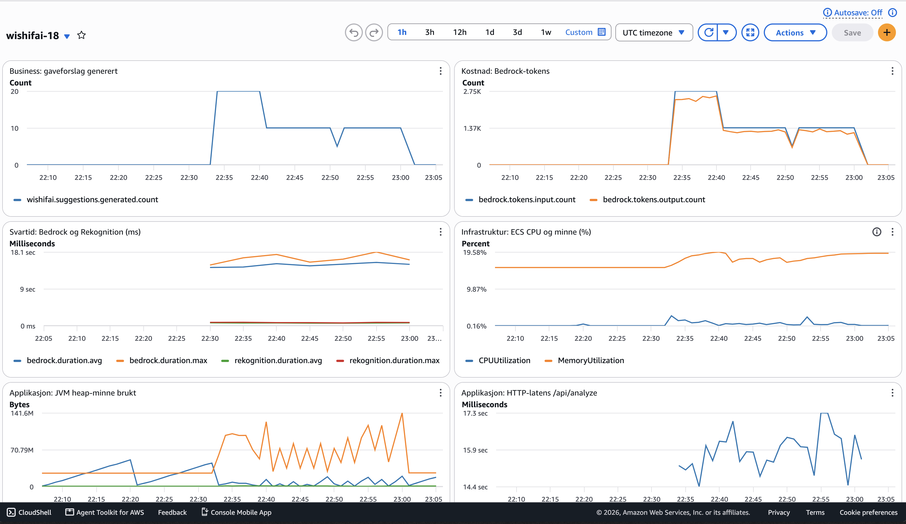
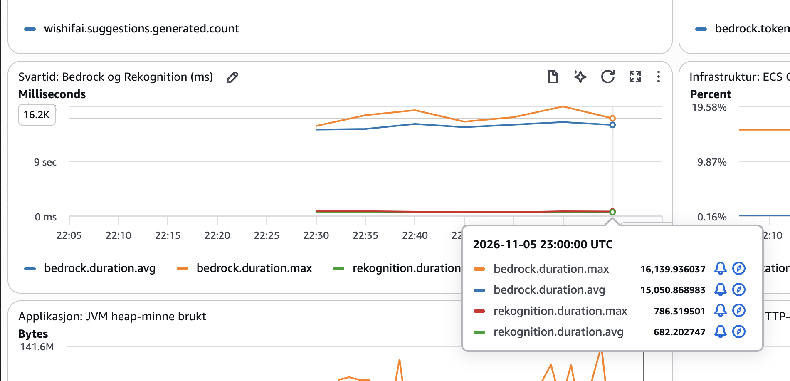

# Besvarelse – PGR301 Eksamen 2026

**Kandidatnummer:** 18

**Offentlig URL til tjenesten:** https://wi-18457fa54bc74920bead38f9c980a621.ecs.eu-west-1.on.aws

Test med `/api/health` (roten gir 404). Detaljer i oppgave 2A.


## Oppgave 1 – Container og CI

### 1A – Containerisering

`Dockerfile` ligger i repo-roten og bruker multi-stage build:

- **Build-stage:** `maven:3.9-eclipse-temurin-21` bygger JAR-filen.
- **Runtime-stage:** `eclipse-temurin:21-jre` inneholder JRE og den ferdige JAR-filen.

#### Bygg imaget

```bash
docker build -t wishifai .
```

#### Kjør containeren (lytter på localhost:9999)

Appen lytter på port 8080 inni containeren, og `-p 9999:8080` gjør den tilgjengelig på `localhost:9999`.

**Alternativ A: AWS-nøkler fra `aws configure`**

```bash
docker run -p 9999:8080 -v ~/.aws:/root/.aws:ro wishifai
```

**Alternativ B: AWS-nøkler som miljøvariabler**

```bash
docker run -p 9999:8080 \
  -e AWS_ACCESS_KEY_ID=$AWS_ACCESS_KEY_ID \
  -e AWS_SECRET_ACCESS_KEY=$AWS_SECRET_ACCESS_KEY \
  -e AWS_REGION=eu-west-1 \
  wishifai
```

### 1B – GitHub Actions og ECR

**Workflow:** `.github/workflows/deploy.yml`
**Grønn kjøring:** https://github.com/MarkusNNilsen/devops-eksamen-2026/actions/runs/41107439479

#### Hva workflowen gjør
Ved push til `main` bygger workflowen Docker-imaget og publiserer det til
ECR-repoet `wishifai-mnn-wishifai` i eu-west-1. Den kjører kun på push til `main`.

#### Secrets
AWS-nøklene ligger i GitHub Secrets (`AWS_ACCESS_KEY_ID` og
`AWS_SECRET_ACCESS_KEY`) og leses via `${{ secrets.* }}`. De ligger ikke i koden.

#### Tagging-strategi
Hvert image får to tags:
- **Commit-SHA** (`github.sha`)
- **`latest`**

#### Begrunnelse
- **Commit-SHA** er unik per commit og sporbar til nøyaktig hvilken kode som
  kjører. Den endres aldri, så den gir trygge rollbacks.
- **`latest`** peker alltid på siste build, så det er enkelt å hente ut nyeste
  image uten å kjenne SHA. Jeg startet med kun SHA, men la til `latest` fordi
  det er praktisk. Den brukes ikke til deploy.
- **Hvorfor ikke bare `latest`:** tags i ECR er mutable, så `latest` flytter seg
  ved hver push. Da vet jeg ikke hvilken commit som kjører i produksjon, jeg kan
  ikke rulle tilbake til en bestemt versjon, og ECS ser ingen endring når taggen
  er lik som sist.


## Oppgave 2 – ECS Express og IaC

### 2A – Infrastruktur

Terraform-koden ligger i [`infra/`](infra/). Den oppretter:

- en ECS Express-tjeneste (`wishifai-18`) med offentlig endepunkt
- en S3-bucket for bildene (`wishifai-images-18`)
- en task role (`wishifai-task-role-18`) med tillatelser til S3 (`PutObject` på kun denne bucketen), Rekognition (`DetectLabels`), Bedrock (`InvokeModel`) og CloudWatch (`PutMetricData`)

Execution role og infrastructure role er de eksisterende rollene fra oppgaven. `S3_BUCKET` settes på tjenesten fra Terraform-ressursen, så bucket-navnet bare står ett sted.

Task role har bare de tillatelsene appen trenger, og S3-tilgangen gjelder kun vår egen bucket. For Rekognition og CloudWatch går det ikke an å begrense hvilke ressurser rollen får bruke, og for Bedrock er det tungvint. Derfor har disse tillatelse til alle ressurser.

**Offentlig URL:** https://wi-18457fa54bc74920bead38f9c980a621.ecs.eu-west-1.on.aws

Roten (`/`) har ingen side og gir 404. Test med:

```bash
curl https://wi-18457fa54bc74920bead38f9c980a621.ecs.eu-west-1.on.aws/api/health
curl -F "image=@samples/sample_image.png" https://wi-18457fa54bc74920bead38f9c980a621.ecs.eu-west-1.on.aws/api/analyze
```

### 2B – Remote state

State lagres i den delte bucketen `pgr301-terraform-state` med nøkkelen:

```
wishifai/18/terraform.tfstate
```

Nøkkelen inneholder kandidatnummeret, så state ikke overskrives av andre kandidater. Backend-konfigurasjonen ligger i [`infra/backend.tf`](infra/backend.tf).

### 2C – GitHub Actions-job for Terraform

**Workflow:** [`.github/workflows/deploy.yml`](.github/workflows/deploy.yml)
**Grønn kjøring:** https://github.com/MarkusNNilsen/devops-eksamen-2026/actions/runs/41138404062

Workflowen har to jobber i samme fil:

1. `build-push` bygger Docker-imaget og pusher det til ECR. Jobben sender adressen til imaget (med commit-SHA som tag) videre som job-output.
2. `terraform` har `needs: build-push`, så den starter først når build-jobben er ferdig og grønn. Den kjører `terraform fmt -check`, `terraform init` og `terraform apply` mot `infra/`, og gir imaget fra build-jobben til Terraform som `image`-variabel. AWS-nøklene hentes fra GitHub Secrets, på samme måte som i 1B.

Pipelinen feiler hvis Terraform-koden ikke er riktig formatert, siden `terraform fmt -check` avslutter med en feilkode når en fil trenger formatering.

#### Hvorfor Terraform kjører etter container-build

- Imaget med riktig tag må finnes i ECR før ECS prøver å hente det. Kjører Terraform først eller parallelt, kan tjenesten peke på et image som ikke finnes ennå, og deployen feiler.
- Adressen til imaget er et resultat av build-jobben (SHA-taggen), så Terraform kan ikke få den uten å vente.
- Med `needs:` stopper pipelinen hvis build feiler, så en ødelagt versjon aldri blir deployet.


## Oppgave 3 – Observability

### 3A – Metrikker

Appen bruker Micrometer og sender metrikker til CloudWatch i namespace `wishifai-18`.

| Metrikk | Type | Hva den måler |
|---|---|---|
| `rekognition.duration` | Timer | Tid brukt på Rekognition-kallet |
| `bedrock.duration` | Timer | Tid brukt på Bedrock-kallet |
| `wishifai.suggestions.generated` | Counter | Antall gaveforslag generert (business) |
| `bedrock.tokens.input` / `bedrock.tokens.output` | Counter | Tokens sendt til og mottatt fra Bedrock |

**Hvorfor disse:** Grunderen opplever at tjenesten er treg. De to timerne måler hvert eksterne kall for seg, så man ser hvilket steg tiden går til. `suggestions.generated` er en business-metrikk som sier noe om bruken av tjenesten, ikke bare teknisk helse.

Jeg måler også tokens, fordi Bedrock faktureres per token, så det er den mest direkte kostnadsindikatoren i tjenesten. Under jevn testtrafikk følger tokenforbruket antall forslag, siden prompten er nesten konstant. Metrikkene måler likevel ulike ting (kostnad og verdi), og de vil avvike hvis prompten, modellen eller svarlengden endres, eller hvis et svar ikke kan parses.

**Namespace:** `MetricsConfig` hadde tomt namespace, så metrikkene ble avvist. Jeg satte `wishifai-18` via miljøvariabelen `METRICS_NAMESPACE`, satt i Terraform. Kandidatnummeret er med fordi alle deler samme AWS-konto, og metrikkene ellers ville blandet seg. Task role fikk også `cloudwatch:PutMetricData`, ellers får ikke appen sendt noe.

### 3B – Dashboard og alarm

Dashboardet `wishifai-18` og alarmen er definert som Terraform i [`infra/dashboard.tf`](infra/dashboard.tf) og [`infra/alarm.tf`](infra/alarm.tf).



| Widget | Type | Hvorfor |
|---|---|---|
| Gaveforslag generert | Business | Viser hvor mye tjenesten brukes |
| Bedrock-tokens (input/output) | Business/kostnad | Bedrock faktureres per token |
| Svartid Bedrock og Rekognition | Egne timere | Viser hvilket steg tiden går til |
| ECS CPU og minne | Infrastruktur | Viser om serveren er overbelastet |
| JVM heap-minne | Applikasjon | Viser minnebruk i appen |
| HTTP-latens `/api/analyze` | Applikasjon | Viser svartiden brukeren opplever |

**Funn:** Bedrock brukte i snitt ca. 15 sekunder per kall, mot ca. 0,7 sekunder for Rekognition, altså omtrent 22 ganger lenger. HTTP-latensen på `/api/analyze` er 14–17 sekunder og følger Bedrock, mens CPU er nær null og minnet rundt 20 %. Tregheten skyldes altså Bedrock og ikke serveren.



**Alarm 1 (`wishifai-18-bedrock-slow`):** går av når gjennomsnittlig `bedrock.duration` er over 20 sekunder i fem minutter. Bedrock dominerer svartiden, så en økning er det første tegnet på at brukerne får en treg tjeneste. Normalnivået er ca. 15 s, og terskelen ligger omtrent 35 % over, så den ikke går av ved vanlig drift. Uten trafikk finnes det ingen data, og alarmen blir stående i OK (`treat_missing_data = notBreaching`). Alarmen har ingen varslingskanal (SNS/e-post), siden oppgaven bare ber om en alarm på en egen metrikk.

**Alarm 2 (`wishifai-18-token-spike`):** går av når summen av output-tokens fra Bedrock er over 30k tokens på fem minutter. Bedrock faktureres per token, så en plutselig topp kan bety spam eller at modellen gir uvanlig lange svar. Terskelen ligger omtrent dobbelt så høyt som det travleste femminuttersvinduet under testingen (ca. 13 000) og om lag fem ganger vanlig testtrafikk (ca. 6 500). Alarmen kan også gå av ved vanlig vekst i bruk, og den oppdager misbruk uten å stoppe det. Selve beskyttelsen ville vært rate limiting.


## Oppgave 4 – Drøfting

### Testing

Ved ikke-deterministisk output kan man ikke teste at svaret er identisk, bare at det har riktige egenskaper og man må måle andelen som består over mange kjøringer. Wishifai har ingen tester i dag. Jeg ville innført enhetstester av de deterministiske delene, som parsingen av Bedrock-svaret, med mock. Kvalitet kan testes med et eval-sett med fast input, for eksempel objektlister fra barnerom, hvor man sjekker at forslagene ikke er farlige eller aldersupassende. Sjekken kan være en ordliste, som er billig men lett å omgå og gir falske treff: en motorsag passer fint i bestefars bod men ikke i barnebarnets rom, og en ordliste ser ikke forskjellen. Alternativt kan en LLM-as-judge vurdere sammenhengen, men den må valideres mot menneskelig vurdering da den også kan ta feil. Eval-settet bør kjøres som en gate i pipelinen før deploy, og når prompt eller modell endres, med en terskel for andel bestått. Siden en test aldri kan bevise at noe aldri skjer, må den suppleres med filter i produksjon og stikkprøver.

### Kontinuerlig leveranse

Ved bruk av AI består en leveranse av mer enn kode: prompt og modellversjon kan endres uavhengig av koden og endrer atferden like mye. Alt må versjoneres og kunne rulles tilbake. I Wishifai gir commit-SHA på imaget rollback, og modell-ID kan settes via en miljøvariabel. ECS Express ruller ut gradvis, men sjekker bare teknisk helse, ikke om svarene er gode. Ved høy risiko bør nye prompter og modeller først gå til en liten andel av trafikken (canary) og passere eval-settet.

### Risiko og ansvar

Siden en LLM aldri blir feilfri, er ikke målet å eliminere feil, men å redusere sannsynligheten og oppdage feil raskt. Praksisene må derfor skaleres med hva en feil koster. For en gaveapp som Wishifai kan man akseptere at enkelte upassende forslag slipper gjennom og rettes etter tilbakemeldinger. I en bank eller medisinsk setting er konsekvensen så alvorlig at det trengs strengere krav før produksjon, større eval-sett og et menneske i loopen som godkjenner endringer i prompt og modell og som vurderer svar før de når kunden. Ansvaret kan ikke overlates til modellen. Organisasjonen som leverer tjenesten har ansvaret for resultatet, og må kunne forklare og etterprøve hva som ble svart, blant annet gjennom logging.

### Overvåking

Jeg har to alarmer: en på Bedrock-svartid over 20 sekunder og en på tokenforbruk som varsler ved uvanlig mange output-tokens og som kan avsløre spam eller at modellen plutselig gir uvanlig lange svar. Token-alarmen kunne vært kombinert med antall ulike brukere, slik at man ser om økningen kommer fra mange eller fra en avsender, og dermed kan skille spam fra vanlig vekst. Latens, feilrater og kostnad viser om tjenesten fungerer, ikke om svaret er bra, så kvalitet må overvåkes med egne signaler. Indirekte signaler er andelen svar som ikke kan parses, svarlengde og tokens per forespørsel, som kan avsløre drift etter en modelloppdatering. Direkte signaler er tilbakemeldinger fra brukere og stikkprøver som vurderes av mennesker eller en LLM-as-judge.